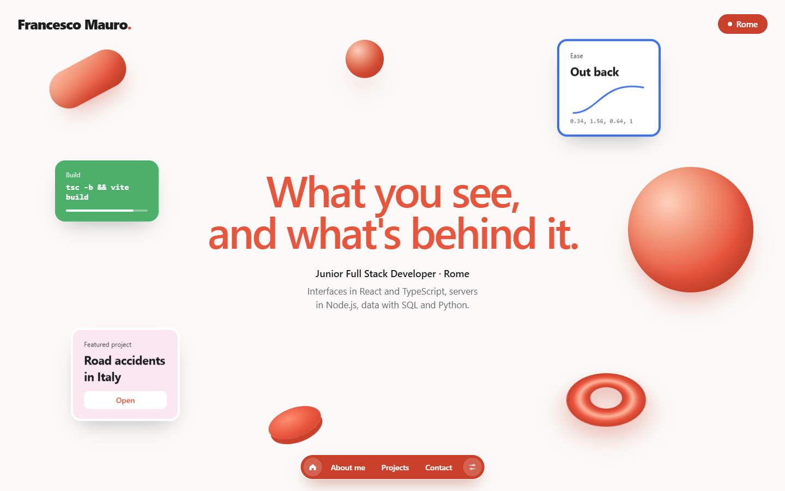

# Animated portfolio · Francesco Mauro



**Demo:** https://francesco-mauro.github.io/portfolio-animato/

**Code comments and folder READMEs:** in Italian.

An animated portfolio page, built with **React + TypeScript + Vite** and no animation library. The look is a mix of styles I liked around the internet: coral 3D shapes and floating cards, a band of technologies that scrolls forever, text that lights up as you scroll, and a Motion switch with Off, On and X-ray. Almost all the animations are CSS. TypeScript drives the cursor, the card tilt, the reveals on scroll, the Manifesto text and the theme change.

The texts come from my CV, my LinkedIn profile and the READMEs of my GitHub repositories, with the sources at the top of `profile.ts`, `projects.ts` and `stack.ts` in `src/data/`.

## Getting started

You need Node.js 20.19+ or 22.12+, as required by Vite 8. Tested with Node 24.

```bash
npm install        # once, downloads the dependencies
npm run dev        # development server on http://localhost:5173
npm run build      # type check (tsc -b) and production build in dist/
npm run preview    # serves the build in dist/ on http://localhost:4173
npm run lint       # checks the code with oxlint
npm run test:unit  # data, workflow and page tests with Vitest, no browser
npm run test:e2e   # end-to-end tests with Playwright in a real browser (tests/)
```

## What you see

| # | Section | What moves |
|---|---|---|
| 1 | **Hero** | the title comes in word by word, five coral shapes float, three cards drift and tilt towards the mouse |
| 2 | **Marquee** | the band with the technologies scrolls forever, even with the mouse over it |
| 3 | **About me** | a sentence stays still in the middle and lights up word by word as you scroll. Below it, a short paragraph and four blocks: education, experience, languages and the role I'm looking for |
| 4 | **Projects** | six cards, each with a real preview of the project that zooms in with the mouse over it. The two featured ones at the top are larger and tell the project in three parts: the starting point, what I did, what came out of it. The other four sit below them, in a row on a wide screen. They come in one after another as you scroll, in CSS only (`animation-timeline: view()`), and tilt towards the mouse |
| 5 | **Contact** | coral background, a disc turns in perspective |

In the four project cards with an online demo, a short video of the demo starts with the mouse over it. The road accidents card has no demo and shows a video of its Power BI dashboard.

Always there: the **cursor** (a dot plus a ring that follows it), and the **pill menu** at the bottom centre. Its last button opens the **preferences panel**, with language, theme and Motion. The **light and dark theme** starts from the system theme, remembers the choice and animates the change with View Transitions. At the top, the **reading bar**: an indigo line that fills up as the page scrolls, in CSS only (`animation-timeline: scroll()`). Switch to another tab and the **tab title** calls you back ("Torna qui 👋", or "Come back 👋" in English), then goes back to normal when you return.

A wrong address gets the site's own **404 page** instead of the grey GitHub one: the coral shapes float, the "404" comes in digit by digit with the torus as its zero, and a button takes you back to the site. It follows the same theme and language as the site.

The site is in **Italian and English**: the preferences panel has an **IT · EN** switch. It starts in the browser's language (Italian if the browser is in Italian, English for everyone else), remembers the choice and changes the texts on the page, including the ones for screen readers and the X-ray labels. Only the page description and the link preview (Open Graph) stay in Italian: LinkedIn, WhatsApp and Telegram build previews without running JavaScript.

## The three motion modes

- **On**: everything moves. This is where it starts.
- **Off**: everything is still and already in place. The site also starts in Off if the system asks for reduced motion (`prefers-reduced-motion`).
- **X-ray**: every piece shows an outline and a label that says how it is made, for example "CSS · sphere · radial gradient".

The mode lives on `<html data-motion="...">`, and the CSS reads it from there (`src/styles/global.css`, `src/styles/xray.css`).

## The structure

```
portfolio-animato/
├── index.html                 the page Vite serves, loads src/main.tsx
├── 404.html                   the page for wrong addresses, loads src/notFound.tsx
├── package.json               dependencies and npm scripts
├── vite.config.ts             Vite config: React plugin, the two pages, the 404 in development, and Vitest config
├── pages.test.ts              checks that the build makes both pages and that they pick theme and language the same way
├── .github/workflows/deploy.yml  tests and deployment to GitHub Pages on every push to main
├── .github/workflows.test.ts     checks that the workflow actions run on Node 24
├── public/                    files served as they are (the favicon, the link preview image)
├── docs/                      documents: the style guide, the screenshot above, and what is in public/
├── tests/                     end-to-end tests: the animations checked in the browser
└── src/
    ├── main.tsx               entry point: global styles and <App />
    ├── notFound.tsx           entry point of the 404 page
    ├── App.tsx                builds the page: sections and fixed menu
    ├── styles/                global CSS: variables, shared rules, X-ray view
    ├── types/                 the TypeScript types of the content
    ├── data/                  the texts of the site in Italian and English: profile, projects, stack, interface, with their tests
    ├── assets/                the images imported by the code: the project previews
    ├── context/               the motion mode (On, Off, X-ray) and the language (IT, EN), shared by the whole page
    ├── hooks/                 the reusable logic: cursor, scroll, entrances, tilt, language
    ├── components/            the reusable pieces: cursor, shapes, cards, menu, preferences (language, theme, Motion), reading bar
    ├── sections/              the five sections of the page, in order
    └── pages/                 the pages that are not the site: the 404
```

`src/` and its folders, `tests/` and `docs/` each have a `README.md` that lists their files, and every file starts with a comment that says what it does.

## Project rules

- **One component, one folder:** `Name.tsx` with `Name.module.css` next to it. Styles stay inside the folder (CSS Modules).
- **Texts live in `src/data/`**, never inside the components, **in Italian and English** (`{ it, en }`). The interface texts are in `ui.ts`. `tests/language.spec.ts` finds any text left in one language only. `npm run test:unit` checks the links, demos, dates and duplicates of the projects. It also checks that the two featured projects come first and that the others stay a multiple of four: on a wide screen they sit in a row of four, so a fifth one would leave three empty spots.
- **Colours live in `src/styles/tokens.css`**, never written by hand elsewhere if the variable exists.
- **The site works with the keyboard** (`tests/keyboard.spec.ts`): the first Tab shows "Skip to content", then the menu, which ends with the preferences button, then the content, each with a two-colour focus ring that shows on any background. The menu sits at the bottom of the screen but comes first in the DOM.
- **Accessibility is checked by axe** (`tests/a11y.spec.ts`, part of `npm run test:e2e`): the page must pass with no violations in every theme and every Motion mode. The easiest thing to break is contrast: small white text goes on the deep coral, not on the coral of the titles, where the contrast is below WCAG AA.
- **Animations respect Off and `prefers-reduced-motion`:** the rules in `global.css` stop every animation, new ones included.

## Deployment: GitHub Pages

The site is online at https://francesco-mauro.github.io/portfolio-animato/ and updates by itself: on every push to `main`, the workflow `.github/workflows/deploy.yml` installs the dependencies, runs the linter, runs the data and workflow tests, builds the site, runs the tests in `tests/` and publishes `dist/` to GitHub Pages. In the build, Vite uses the base path `/portfolio-animato/` (in `vite.config.ts`). In development it stays `/`.

## The commit history

The first twelve commits, up to `ci: deploy to GitHub Pages with GitHub Actions`, were reorganised into steps before publishing, on 5 November 2026. Each one compiles and passes the linter, and all twelve carry that day's time, a few seconds apart. Every later commit is a real change, with the date it was made.

## Documents

- [docs/STILI.md](docs/STILI.md), in Italian: the style guide (colours, fonts, shapes, curves and movements, each with the file where it lives).
- [docs/README.md](docs/README.md): the documents folder, and what the files in `public/` do.
